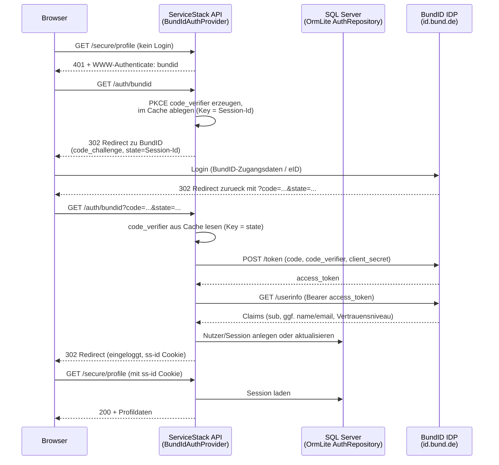

# Spike: BundID-Anbindung in einem ServiceStack-Projekt mit SQL Server

## Fragestellung

Kann **BundID** (id.bund.de, das zentrale Nutzerkonto des Bundes fuer
Online-Verwaltungsleistungen nach OZG) als externer Login-Provider in ein
**ServiceStack**-Backend integriert werden, das Nutzer- und Sessiondaten in
**SQL Server** persistiert - und wie sieht eine idiomatische, mit
ServiceStack-Bordmitteln umsetzbare Loesung dafuer aus?

## Ergebnis in einem Satz

**Ja, machbar.** BundID spricht (fuer die Anbindung von Fachverfahren)
OpenID Connect / OAuth2 Authorization Code Flow; ServiceStack bringt mit
`OAuth2Provider` eine generische Basisklasse fuer genau dieses Protokoll
mit, die sich sauber erweitern laesst. Persistierung von Nutzer- und
Sessiondaten funktioniert ueber `ServiceStack.OrmLite` + SQL Server ohne
zusaetzliche Frameworks (kein EF Core noetig). Der Code in diesem Repository
ist ein lauffaehiges Geruest davon - **kein** production-ready Produkt (siehe
"Offene Punkte").

## Vorgehen

1. Recherche: Wie authentifiziert BundID Fachverfahren technisch? (OIDC
   Authorization Code Flow, PKCE)
2. Recherche: Wie baut man in ServiceStack 10.x einen eigenen
   OIDC/OAuth2-Login-Provider? (`ServiceStack.Auth.OAuth2Provider` als
   Basisklasse, verifiziert anhand des ServiceStack-Quellcodes)
3. Aufbau eines lauffaehigen .NET-8-/ServiceStack-Projekts mit
   - einem SQL-Server-Backend ueber OrmLite (`ConfigureDb`)
   - einem darauf aufsetzenden `OrmLiteAuthRepository` fuer Nutzer- und
     Session-Daten (`ConfigureAuth`)
   - einem eigenen `BundIdAuthProvider` fuer den OIDC/PKCE-Login
   - einem geschuetzten Beispiel-Endpunkt (`/secure/profile`)
4. Verifikation: Projekt gebaut (`dotnet build`) und lokal gestartet;
   HTTP-Requests gegen `/hello`, `/secure/profile` (401 ohne Login) und
   `/auth/bundid` (Redirect-Aufbau inkl. PKCE) gepruefth - siehe
   "Was wurde verifiziert" unten.

## Architektur



### Komponenten

| Datei | Zweck |
|---|---|
| `src/BundIdSpike.Api/Auth/BundIdAuthProvider.cs` | Kern des Spikes: OIDC-Login gegen BundID, inkl. PKCE |
| `src/BundIdSpike.Api/Configure.Auth.cs` | Registriert `AuthFeature` + `OrmLiteAuthRepository<UserAuth, UserAuthDetails>` (SQL Server) |
| `src/BundIdSpike.Api/Configure.Db.cs` | Registriert die SQL-Server-Verbindung ueber `ServiceStack.OrmLite` |
| `src/BundIdSpike.Api/AppHost.cs` | Initialisiert das DB-Schema beim Start (`InitSchema()`) |
| `src/BundIdSpike.ServiceModel/SecureProfile.cs` | Beispiel eines `[Authenticate]`-geschuetzten Endpunkts |

### Warum `OAuth2Provider` als Basis?

ServiceStack bringt mit `ServiceStack.Auth.OAuth2Provider` bereits die
komplette Authorization-Code-Flow-Mechanik mit (Redirect-Aufbau,
State-Handling ueber die Session-Id, Token-Austausch, Fehlerbehandlung) -
dieselbe Basis, die auch die eingebauten Provider (GitHub, Microsoft
Graph, ...) nutzen. `BundIdAuthProvider` erweitert sie um:

- **PKCE (RFC 7636, S256)**: BundID (wie die meisten modernen OIDC-IDPs)
  erwartet PKCE. `OAuth2Provider` unterstuetzt das nicht nativ, stellt aber
  mit `PreAuthUrlFilter`/`AccessTokenUrlFilter` genau die noetigen
  Erweiterungspunkte bereit. Der `code_verifier` wird ueber den
  ServiceStack-Cache zwischengespeichert, korreliert ueber denselben Wert,
  den `OAuth2Provider` intern bereits als OAuth-`state` verwendet (die
  ServiceStack-Session-Id) - verifiziert durch Lektuere des
  ServiceStack-Quellcodes (`OAuth2Provider.AuthenticateAsync`).
- **UserInfo-Abruf**: `CreateAuthInfoAsync` ruft den BundID-UserInfo-Endpoint
  mit dem erhaltenen Access-Token auf.
- **Claim-Mapping**: `LoadUserAuthInfoAsync` mappt `sub` (pseudonyme,
  dienstespezifische BundID-Kennung) sowie optionale Claims wie
  Vertrauensniveau in die ServiceStack-Session (`AuthUserSession.Meta`).

### Warum `OrmLiteAuthRepository` statt ASP.NET-Core-Identity/EF Core?

Die aktuellen offiziellen ServiceStack-.NET-Templates (Stand: Auswertung
der `NetCoreTemplates`-Repos) sind fuer neue Vollanwendungen auf
`IdentityAuth.For<ApplicationUser>()` (ASP.NET Core Identity + EF Core)
umgestiegen. Fuer diesen Spike wurde bewusst der klassische,
OrmLite-basierte `OrmLiteAuthRepository<UserAuth, UserAuthDetails>` gewaehlt,
weil er
1. ohne EF Core/Migrationen auskommt (weniger bewegliche Teile fuer einen
   Spike),
2. SQL Server direkt ueber `ServiceStack.OrmLite` anspricht - also exakt die
   in der Aufgabenstellung geforderte "ServiceStack + SQL Server"-Anbindung
   ohne einen zweiten, parallelen ORM-Layer nur fuer Auth-Daten.

Fuer ein produktives Vollsystem mit eigener Registrierung/Passwort-Login
kann `IdentityAuth`/EF Core dennoch die bessere Wahl sein - siehe
"Offene Punkte".

## Was wurde verifiziert

Lokal gebaut (.NET 8 SDK, `dotnet build`) und mit `dotnet run` gestartet
(kein SQL Server und keine echten BundID-Zugangsdaten in dieser Umgebung
verfuegbar, daher mit Platzhalter-/Test-Werten getestet):

- `GET /hello/{Name}` → `200 OK` mit JSON-Antwort.
- `GET /secure/profile` **ohne** Login → `401 Unauthorized` mit
  `WWW-Authenticate: bundid realm="https://id.bund.de/"` - der
  `[Authenticate]`-Schutz und die Provider-Registrierung greifen korrekt.
- `GET /auth/bundid` mit Test-Client-Credentials → `302 Redirect` zur
  konfigurierten Authorize-URL, **inklusive korrekt gesetztem
  `code_challenge`/`code_challenge_method=S256`** und `state` (= Session-Id) -
  die PKCE-Implementierung erzeugt und verankert den Redirect korrekt.
- `GET /auth/bundid` **ohne** konfigurierte SQL-Server-Verbindung → App
  startet dennoch (mit klarer Warnung im Log), nicht-DB-Endpunkte bleiben
  nutzbar; DB-Endpunkte melden einen eindeutigen
  SQL-Verbindungsfehler statt eines haengenden Requests (siehe Fund unten).
- `GET /auth/bundid` mit korrekt konfigurierter SQL-Server-Anbindung, aber
  ohne erreichbaren Server → sauberer Fehler `40 - Could not open a
  connection to SQL Server`, den ServiceStack als
  `500`-JSON-Fehlerantwort durchreicht.

**Nicht verifizierbar in dieser Umgebung** (kein Docker-Daemon, kein
Internetzugang zu id.bund.de aus der Sandbox): der komplette Roundtrip
inkl. echtem BundID-Login und echtem Token-/UserInfo-Austausch, sowie der
tatsaechliche SQL-Server-Schreib-/Lesezugriff. Das Setup ist aber inklusive
`docker-compose.yml` vorbereitet, um dies auf einer Entwickler-Maschine mit
Docker- und Internetzugriff nachzuvollziehen.

## Fund waehrend des Spikes: `InitSchema()` nicht lazy beim ersten Login aufrufen

Erste Implementierung hat `OrmLiteAuthRepository.InitSchema()` lazy beim
ersten DI-Resolve aufgerufen (Standard-Pattern in vielen Beispielen). Das
fuehrte dazu, dass der *erste Login-Request* minutenlang haengen blieb,
wenn SQL Server nicht erreichbar ist (SqlClient-Verbindungsaufbau
blockiert synchron im Request-Pfad). Fix: Schema-Initialisierung explizit
und einmalig beim App-Start (`AppHost.Configure()`), mit Try/Catch und
klarer Log-Meldung - siehe `AppHost.cs`. Empfehlung fuer die produktive
Umsetzung: zusaetzlich einen Health-Check-Endpunkt fuer die
DB-Erreichbarkeit ergaenzen.

## Fund: ServiceStack-AppSettings-Konvention und appsettings.json

ServiceStacks `oauth.{provider}.*`-Konvention fuer Provider-Konfiguration
stammt aus der Zeit vor .NET Core (flache `.txt`/Web.config-AppSettings)
und wird von `NetCoreAppSettings.GetString()` **nicht** automatisch von
Punkt- in Doppelpunkt-Notation uebersetzt. In `appsettings.json` muessen
die Schluessel deshalb als **flache, woertlich gepunktete Strings**
angelegt werden:

```json
"oauth.bundid.ConsumerKey": "...",
```

und **nicht** als verschachteltes JSON-Objekt

```json
"oauth": { "bundid": { "ConsumerKey": "..." } }
```

- Letzteres wird von ServiceStack unter dieser Konvention stillschweigend
  **nicht gefunden** (kein Fehler, einfach `null`/leer). Dieser Unterschied
  ist beim ersten Versuch nicht aufgefallen und erst durch Testen des
  tatsaechlichen Redirects sichtbar geworden - ein Punkt, den man bei jeder
  ServiceStack-.NET-Core-Konfiguration ueber `IAppSettings` im Hinterkopf
  behalten sollte.

## Offene Punkte / Risiken (vor produktiver Umsetzung zu klaeren)

1. **Registrierung bei der ITZBund.** Reale Client-ID/-Secret,
   Authorize-/Token-/UserInfo-Endpunkte (Test- und Produktivumgebung) und
   erlaubte Redirect-URIs gibt es erst nach Registrierung des
   Fachverfahrens. Ohne das ist kein echter End-to-End-Test moeglich.
2. **Exakte Claim-Namen.** Die in `BundIdAuthProvider` hinterlegten
   Claim-Namen (`sub`, `name`, `email`, sowie der Platzhalter
   `urn:zwd:1.0:loa` fuer das Vertrauensniveau) sind sinnvolle, nach
   OIDC-Standard plausible Annahmen, aber **nicht** gegen die offizielle
   BundID-Schnittstellendokumentation verifiziert. Muss mit der
   technischen Doku/Testumgebung abgeglichen werden.
3. **Vertrauensniveau & eID-Daten.** BundID kennt mehrere
   Vertrauensniveaus (u.a. Basis-Konto per Nutzername/Passwort vs. Login
   mit Online-Ausweisfunktion). Attribute aus der Personalausweis-eID
   (Name, Adresse, Geburtsdatum, ...) werden ueber einen separaten Weg (den
   eID-Service, nicht notwendigerweise als einfacher OIDC-Claim) bereitgestellt.
   Falls diese Daten fachlich benoetigt werden, ist das in einer eigenen
   Iteration zu klaeren.
4. **PKCE als Pflicht vs. Option.** Es ist nicht oeffentlich verifiziert, ob
   PKCE fuer *confidential* Clients (Server-zu-Server mit `client_secret`,
   wie hier) bei BundID verpflichtend oder nur empfohlen ist. Der Code
   unterstuetzt es in jedem Fall; sollte der IDP unbekannte Parameter
   ablehnen, ist `PreAuthUrlFilter`/`AccessTokenUrlFilter` der Ort, um es
   abzuschalten.
5. **Datenschutz/BSI-Anforderungen.** Eine Anbindung an ein
   Bundes-Nutzerkonto unterliegt typischerweise zusaetzlichen
   Anforderungen (u.a. TR-Vorgaben des BSI, Barrierefreiheit,
   Datenschutz-Folgenabschaetzung). Dieser Spike deckt nur die technische
   Machbarkeit ab, keine rechtlich/organisatorischen Anforderungen.
6. **Session-/Cache-Backend.** Der PKCE-`code_verifier` liegt aktuell im
   Default-ServiceStack-Cache (In-Memory). Bei Mehrinstanz-Betrieb
   (mehrere API-Instanzen hinter einem Load Balancer) muss ein verteilter
   Cache (z.B. `ServiceStack.Redis` oder ein DB-basierter Cache) konfiguriert
   werden, sonst schlaegt der Callback auf einer anderen Instanz fehl.
7. **Produktions-Haertung fehlt bewusst**: keine Rate-Limits, kein
   CSP/CORS-Hardening, keine strukturierte Fehlerseiten, kein Logout-Flow
   gegen BundID (RP-Initiated Logout), kein Refresh-Token-Handling, kein
   Audit-Logging. Alles Themen fuer eine produktive Story, nicht fuer den
   Spike.
8. **Automatisierte Tests fehlen.** Der Spike wurde manuell per `curl`
   verifiziert (siehe oben); es gibt keine Integrationstests, u.a. weil
   kein echter BundID-Testzugang vorliegt.

## Empfehlung / naechste Schritte

1. Zugang zur BundID-Testumgebung bei der ITZBund beantragen (Registrierung
   als Fachverfahren) und damit Punkte 1-4 aus "Offene Punkte" klaeren.
2. `BundIdAuthProvider` gegen die echte Testumgebung end-to-end verifizieren
   (Redirect, Callback, Claim-Mapping) und Claim-Namen ggf. anpassen.
3. Klaeren, ob/welche eID-Attribute fachlich benoetigt werden - falls ja,
   den eID-Service-Teil der BundID-Schnittstelle als eigenes Spike-Folge-Item
   untersuchen.
4. Bei Mehrinstanz-Betrieb: verteilten Cache fuer PKCE-Verifier einplanen.
5. Auf Basis dieses Spikes einen Umsetzungs-Task mit den unter "Offene
   Punkte" 5-8 aufgefuehrten Haertungsthemen schneiden.
